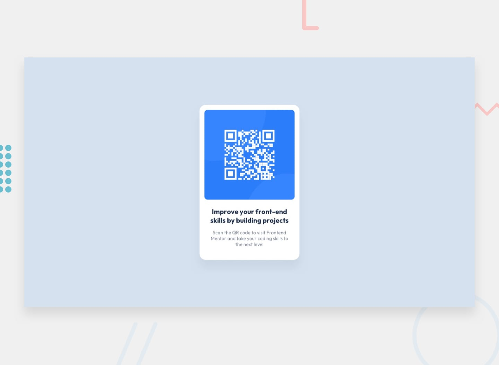

# Frontend Mentor - Composant code QR

## Bienvenue ! 👋

Merci d'avoir relevé ce défi de codage front-end.

Les défis [Frontend Mentor](https://www.frontendmentor.io) vous aident à améliorer vos compétences en codage en construisant des projets réalistes.

**Pour relever ce défi, vous avez besoin d'une compréhension de base du HTML et du CSS.**

## Le défi

Votre défi est de créer ce composant de code QR et de le rendre aussi proche que possible du design.

Vous pouvez utiliser tous les outils de votre choix pour vous aider à relever le défi. Donc, si vous avez quelque chose que vous aimeriez mettre en pratique, n'hésitez pas à l'essayer.

### Vous voulez du soutien pour relever le défi ? 

[Rejoignez notre communauté](https://www.frontendmentor.io/community) et posez des questions dans le canal **#help**.

## Où trouver tout

Votre tâche consiste à créer le projet selon les conceptions contenues dans le dossier `/design`. Vous trouverez à la fois une version mobile et une version de bureau du design. 

Les dessins sont au format statique JPG. L'utilisation de JPG signifie que vous devrez faire preuve de votre meilleur jugement pour des styles tels que « taille de police », « rembourrage » et « marge ». 

Si vous souhaitez que le fichier de conception Figma acquière de l'expérience dans l'utilisation d'outils professionnels et construise plus rapidement des projets plus précis, vous pouvez [s'inscrire en tant que membre PRO](https://www.frontendmentor.io/pro).

Vous trouverez tous les éléments requis dans le dossier `/images`. Les actifs sont déjà optimisés.

Il existe également un fichier « style-guide.md » contenant les informations dont vous aurez besoin, telles que la palette de couleurs et les polices.

## Utiliser les assistants de codage IA

Nous avons inclus deux fichiers pour vous aider si vous utilisez des assistants de codage IA (comme Claude, GitHub Copilot, Cursor, etc.) tout en travaillant sur ce défi :

- `AGENTS.md` - Contient des instructions détaillées pour les assistants IA sur la façon de vous aider à relever ce défi. Il est adapté au niveau de difficulté de ce défi, de sorte que l'IA fournira des conseils adaptés à votre stade d'apprentissage, offrant plus de soutien pour les défis débutants et encourageant plus d'indépendance pour les défis avancés.
- `CLAUDE.md` - Un fichier pointeur qui dirige les outils basés sur Claude vers les instructions AGENTS.md.

**Comment les utiliser :** Vous n'avez rien à faire ! Ces fichiers sont automatiquement détectés par la plupart des outils de codage d'IA. L’IA les lira et ajustera son comportement pour devenir un meilleur partenaire d’apprentissage, vous guidant vers des solutions plutôt que de simplement vous donner les réponses.

**Remarque :** Ces fichiers sont conçus pour vous aider à *apprendre*, et non pour faire le travail à votre place. L’IA est chargée de poser des questions, de donner des indices et d’expliquer des concepts plutôt que d’écrire des solutions complètes.

## Construire votre projet

N'hésitez pas à utiliser n'importe quel flux de travail avec lequel vous vous sentez à l'aise. Vous trouverez ci-dessous un processus suggéré, mais ne vous sentez pas obligé de suivre ces étapes :

1. Initialisez votre projet en tant que référentiel public sur [GitHub](https://github.com/). La création d'un dépôt facilitera le partage de votre code avec la communauté si vous avez besoin d'aide. Si vous ne savez pas comment procéder, [lisez cette ressource Try Git](https://try.github.io/).
2. Configurez votre référentiel pour publier votre code sur une adresse Web. Cela sera également utile si vous avez besoin d'aide lors d'un défi, car vous pouvez partager l'URL de votre projet avec l'URL de votre dépôt. Il existe plusieurs façons de procéder et nous proposons quelques recommandations ci-dessous.
3. Parcourez les conceptions pour commencer à planifier la manière dont vous allez aborder le projet. Cette étape est cruciale pour vous aider à anticiper la création de styles réutilisables par les classes CSS.
4. Avant d'ajouter des styles, structurez votre contenu avec HTML. Écrire d'abord votre code HTML peut vous aider à concentrer votre attention sur la création d'un contenu bien structuré.
5. Écrivez les styles de base de votre projet, y compris les styles de contenu généraux, tels que « font-family » et « font-size ».
6. Commencez à ajouter des styles en haut de la page et travaillez vers le bas. Ne passez à la section suivante qu'une fois que vous êtes satisfait d'avoir terminé le domaine sur lequel vous travaillez.

## Déployer votre projet

Comme mentionné ci-dessus, il existe de nombreuses façons d’héberger votre projet gratuitement. Nos hôtes recommandés sont :

- [Pages GitHub](https://pages.github.com/)
- [Vercel](https://vercel.com/)
- [Netlify](https://www.netlify.com/)

Vous pouvez héberger votre site en utilisant l'une de ces solutions ou l'un de nos autres fournisseurs de confiance. [En savoir plus sur nos hôtes recommandés et de confiance](https://www.frontendmentor.io/guides/hosting-your-solution).

## Créez un `README.md` personnalisé

Nous vous recommandons fortement d'écraser ce « README.md » par un fichier personnalisé. Nous avons fourni un modèle dans le fichier [`README-template.md`](./README-template.md) dans ce code de démarrage.

Le modèle fournit un guide sur ce qu'il faut ajouter. Un « README » personnalisé vous aidera à expliquer votre projet et à réfléchir sur vos apprentissages. N'hésitez pas à modifier notre modèle autant que vous le souhaitez.

Une fois que vous avez ajouté vos informations au modèle, supprimez ce fichier et renommez le fichier « README-template.md » en « README.md ». Cela le fera apparaître comme fichier README de votre référentiel.

## Soumettre votre solution

Soumettez votre solution sur la plateforme pour que le reste de la communauté puisse la voir. Suivez notre ["Guide complet pour soumettre des solutions"](https://www.frontendmentor.io/guides/how-to-submit-solutions) pour obtenir des conseils sur la façon de procéder.

N'oubliez pas que si vous recherchez des commentaires sur votre solution, assurez-vous de poser des questions lorsque vous la soumettez. Plus vos questions sont précises et détaillées, plus vous avez de chances d'obtenir de précieux commentaires de la communauté.

## Partager votre solution

Il existe plusieurs endroits où vous pouvez partager votre solution :

1. Partagez votre page de solution dans le canal **#finished-projects** de la [communauté](https://www.frontendmentor.io/community). 
2. Partagez sur [X (anciennement Twitter)](https://x.com/frontendmentor) et mentionnez **@frontendmentor**, y compris le dépôt et les URL en direct dans votre message. Nous serions ravis de jeter un œil à ce que vous avez construit et de vous aider à le partager.
3. Partagez votre solution sur [LinkedIn](https://www.linkedin.com/company/frontend-mentor/).
4. Blog sur votre expérience dans la construction de votre projet. Écrire sur votre flux de travail, vos choix techniques et parler de votre code est un excellent moyen de renforcer ce que vous avez appris. Les excellentes plates-formes sur lesquelles écrire sont [dev.to](https://dev.to/), [Hashnode](https://hashnode.com/) et [CodeNewbie](https://community.codenewbie.org/).

Nous fournissons des modèles pour vous aider à partager votre solution une fois que vous l'avez soumise sur la plateforme. Veuillez les modifier et inclure des questions spécifiques lorsque vous recherchez des commentaires. 

Plus vos questions sont précises, plus il est probable qu'un autre membre de la communauté vous fasse part de ses commentaires.

## Vous avez des commentaires à nous faire ?

Nous aimons recevoir des commentaires ! Nous cherchons toujours à améliorer nos défis et notre plateforme. Donc, si vous avez quelque chose que vous aimeriez mentionner, veuillez envoyer un e-mail à hi[at]frontendmentor[dot]io.

Ce défi est entièrement gratuit. Veuillez le partager avec toute personne qui le trouvera utile pour la pratique.

**Amusez-vous à construire !** 🚀